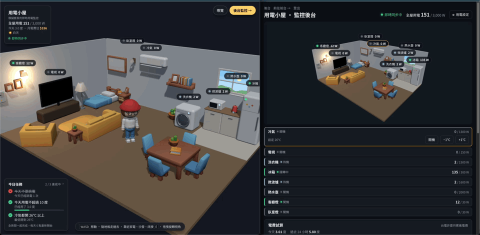
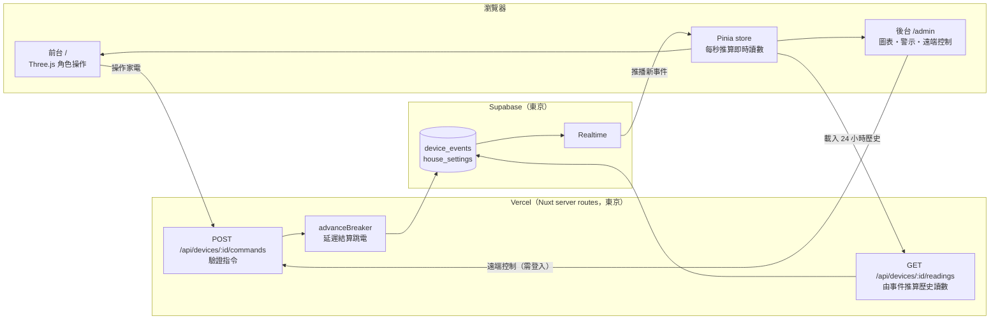

# 用電小屋

[](https://github.com/Swimming0319/my-home-ems/actions/workflows/ci.yml)

一間全站共用的 3D 小套房：操控 Q 版角色開關家電，用電量、警示、跳電會即時同步到監控後台。

**線上展示：https://my-home-ems.vercel.app**（後台：[/admin](https://my-home-ems.vercel.app/admin)，不登入是唯讀的訪客模式）



> 開兩個視窗，一邊前台、一邊後台，就能看到即時同步。第一次進前台會有一分鐘的新手導覽：開家電 → 超過契約容量跳電 → 到電箱復電。

Nuxt 4 · TypeScript · Three.js · Pinia · Tailwind CSS v4 · Chart.js · Supabase（Postgres + Realtime）· Vercel

## 技術亮點

- **用電讀數不存資料庫**：只在狀態改變時寫一筆事件，讀數由純函式依「當時的狀態＋經過時間」推算（冷氣開機高峰、洗衣行程、冰箱壓縮機循環），前後端共用同一份模型 [`shared/utils/powerModel.ts`](shared/utils/powerModel.ts)。雜訊用電器 id 與時間槽當種子，同一個時間點查幾次都一樣，圖表輪詢時不會亂跳。
- **跳電「延遲結算」**：伺服器沒有背景程序盯著用電，而是在送指令、讀取狀態時，算出從上次結算到現在第一個該跳電的精確時間點，把斷電事件補寫在那個時間點上。沒人在線時超載，下次有人打開頁面，歷史一樣正確（[`server/utils/breaker.ts`](server/utils/breaker.ts)）。
- **後端是唯一的真實來源**：前台、後台都只送指令，由後端驗證後寫入事件，再由 Supabase Realtime 推播給所有人；Realtime 斷線時自動退回 10 秒輪詢，重新連上時補抓一次。另外用 Realtime Presence 顯示「N 人在線」，別人操作家電時跳出「有人打開了冷氣」的提示，共用房間裡家電不會像是自己在變。
- **權限分層**：玩家操作家電公開；遠端控制、遠端復電、修改閾值與契約容量需要管理員登入。管理員用 **Google 登入**（Supabase Auth，PKCE），伺服器自己向 Supabase 驗證 token、再對照允許名單決定是不是管理員，登入（你是誰）與授權（你能做什麼）分開；管理密碼保留當備用。兩種方式最後都發同一種加密的 httpOnly session cookie。沒登入的後台是唯讀訪客模式，寫入的 API 在伺服器端另外擋，指令與登入都有限流。
- **3D 互動全部自製**：Q 版角色用基本幾何體組成，走路、蹲下、拿遙控器、坐躺都是程式產生的動畫並依權重混合；點擊移動用網格 A* 繞過家具；斜放家具的碰撞用旋轉後的方塊計算。電視節目、洗衣機的水流、窗外天色都是即時畫的。
- **貼近真實的規則**：台電住宅累進電價試算月電費、全屋契約容量 3,000 W 超載 10 秒跳電、跟著瀏覽器時間的日夜循環、每日省電任務。每個數字的來由（哪些是為了展示刻意放大）記在[規劃文件](smart-room-spec.md)。
- **測試**：Vitest 單元測試涵蓋用電模型、跳電結算與復電、指令驗證、警示規則、電費、每日任務、碰撞與尋路。

## 架構



家電的耗電只取決於當下狀態與經過多久，所以只在狀態改變時記一筆 `device_events`，圖表要的讀數在查詢時才算出來。洗衣行程切換、冰箱壓縮機這類「時間到了自己變化」的狀態不會產生事件，前端用同一份模型自己推算。警示紀錄也是由歷史讀數推算，不另外存表。產品規劃、用電模型、警示規則與決策紀錄見 [smart-room-spec.md](smart-room-spec.md)。

---

以下是開發文件。

## 本機開發

```sh
npm install
npm run dev        # http://localhost:3010
npm test           # Vitest：用電模型、指令驗證、警示規則、資料存取
npm run typecheck  # 型別檢查（vue-tsc）；push 到 main 時 GitHub Actions 會自動跑這兩項
```

**不設定 Supabase 也能直接跑**：後端偵測到 `NUXT_PUBLIC_SUPABASE_URL`／`NUXT_SUPABASE_SERVICE_KEY` 沒填時會改用記憶體模式，狀態與歷史在伺服器重啟後清空。

| 頁面 | 說明 |
|---|---|
| `/` | 前台：操控角色在房間裡走動，走到家電旁邊使用（WASD／方向鍵、點地板走過去、靠近家電按 E 或點「使用」） |
| `/?hour=21.5` | 前台固定在某個時間（預覽晚上、傍晚的樣子；後台也支援） |
| `/character` | 角色預覽：切換待機／走路／拿遙控器／蹲下，網址可指定 `?pose=remote&angle=-30` |
| `/admin` | 後台：全屋用電、警示紀錄、24 小時用電曲線與倒帶。沒登入是訪客模式（唯讀）；登入後才能遠端控制家電、遠端復電、調整閾值與契約容量 |

兩個頁面同時開著，在任一邊操作家電，另一邊會即時同步。

## 接上 Supabase

1. 在 Supabase 後台 → SQL Editor 執行 [supabase/schema.sql](supabase/schema.sql)（建表、索引、RLS、Realtime、8 台電器的初始資料；可重複執行）。已經跑過舊版 schema 的環境，改執行 `supabase/patch-*.sql` 補上差異
2. 複製 `.env.example` 成 `.env`，填入三個值（Project Settings → API Keys）：
   - `NUXT_PUBLIC_SUPABASE_URL`：Project URL，`https://xxxx.supabase.co`，**不要**填結尾多了 `/rest/v1/` 的 REST endpoint
   - `NUXT_SUPABASE_SERVICE_KEY`：secret key，只在伺服器端使用
   - `NUXT_PUBLIC_SUPABASE_KEY`：publishable key，給瀏覽器訂閱 Realtime；沒填的話前端退回每 10 秒輪詢
   - `NUXT_ADMIN_PASSWORD`：後台管理密碼（可選）。沒有 Supabase 的記憶體模式只能用密碼登入
   - `NUXT_ADMIN_EMAILS`：可以用 Google 登入後台的信箱，逗號分隔（可選，見下方「後台的 Google 登入」）
   - 兩者都沒填時：`npm run dev` 不需要登入（直接有管理權限）；正式環境沒有人能登入，後台只剩訪客模式
3. 重開 `npm run dev`，終端機不再出現「改用記憶體模式」的警告、頁面顯示「即時同步中」就代表都接上了

## API

| 方法 | 路徑 | 說明 |
|---|---|---|
| GET | `/api/devices` | 電器清單（含 `room_position`、`power_threshold_watts`） |
| GET | `/api/devices/:id/readings?range=24h` | 時間範圍內的讀數，依時間排序；`range` 支援 `m`/`h`/`d`，最長 `7d` |
| GET | `/api/events/latest` | 每台電器目前生效的事件 |
| POST | `/api/devices/:id/commands` | 操作家電，每個 IP 每分鐘最多 30 次；`source: "admin"` 需要登入；新手導覽中帶 `guided: true` |
| PATCH | `/api/devices/:id` | 改閾值 `{ power_threshold_watts }`（需要登入） |
| GET／PATCH | `/api/settings` | 讀取契約容量與停電狀態 `{ house_limit_watts, tripped_at }`；PATCH 修改契約容量（需要登入） |
| POST | `/api/breaker/check` | 結算跳電與停電 5 分鐘的自動復電，回傳 `{ tripped_at }`；公開、可重複呼叫 |
| GET | `/api/breaker/trips` | 過去 24 小時的每次跳電（`{ at, guided }` 陣列；`guided` 是新手導覽示範造成的，不算進每日任務） |
| POST | `/api/breaker/reset` | 復電 `{ source: 'player' \| 'admin' }`，回傳 `{ restored }`；admin 需要登入 |
| GET／POST | `/api/admin/session`、`/api/admin/login`、`/api/admin/logout` | 後台登入狀態、密碼登入、登出（每個 IP 每分鐘最多試 5 次） |
| POST | `/api/admin/google` | Google 登入後換 session `{ access_token }`：伺服器向 Supabase 驗證 token，信箱在 `NUXT_ADMIN_EMAILS` 裡才發 cookie |

指令格式：

```jsonc
{ "action": "power_on" | "power_off" | "set_temp", "set_temp_c": 24, "source": "player" | "admin" }
```

- 冷氣溫度 20–30°C 整數；關機時也能先設定溫度
- 洗衣機的 `power_on` 是啟動一輪 60 分鐘的洗衣行程，洗完自動回到待機
- 狀態沒有改變（已經開機又按開機）回傳 `changed: false`，不寫入事件

讀數格式（[shared/types/smartRoom.ts](shared/types/smartRoom.ts)）：

```ts
{ device_id, timestamp, power_watts, water_liters, status, set_temp_c, wash_phase }[]
```

## 素材

- 角色：自製 Q 版角色（`app/utils/chibiCharacter.ts`），沒有使用外部模型
- 家電：自製（`RoomScene.vue` 的 builder），圓角方塊組成
- 家具：[KayKit Furniture Bits](https://github.com/KayKit-Game-Assets/KayKit-Furniture-Bits-1.0)（Kay Lousberg，CC0），只放用到的模型在 `public/models/furniture/`，擺放位置在 `app/utils/roomFurniture.ts`。**不要用標了「不允許使用 AI」（NoAI）的素材**，授權禁止把它們交給 AI 處理

## 部署到 Vercel

- 環境變數：`NUXT_PUBLIC_SUPABASE_URL`、`NUXT_SUPABASE_SERVICE_KEY`、`NUXT_PUBLIC_SUPABASE_KEY`、`NUXT_ADMIN_EMAILS` 和／或 `NUXT_ADMIN_PASSWORD`
- Supabase 專案建在東京的話，Vercel functions 的區域也要設在東京附近，不然每次查詢都要繞一趟美國
- **管理密碼要用夠長的隨機密碼**：有設定時，登入 cookie 的加密金鑰是從這組密碼衍生的（只開 Google 登入時改由 Supabase 的 secret key 衍生）

## 後台的 Google 登入

管理員登入可以用 Google 帳號，不用記密碼。只有後台的「管理員登入」會用到，前台與後台訪客模式都不需要登入。

1. Google Cloud Console 建立 OAuth 用戶端（網頁應用程式），「已授權的重新導向 URI」填 Supabase 給的 Callback URL（`https://xxxx.supabase.co/auth/v1/callback`）
2. Supabase → Authentication → Sign In / Providers → Google：開啟，貼上用戶端 ID 與密鑰
3. Supabase → Authentication → URL Configuration：Site URL 填正式網址，Redirect URLs 加上 `https://正式網域/admin/login`（本機測試再加 `http://localhost:3010/admin/login`）
4. 環境變數 `NUXT_ADMIN_EMAILS` 填允許的信箱

流程：瀏覽器透過 Supabase Auth（PKCE）跳去 Google → 回到 `/admin/login?code=…` 換成 access token → `POST /api/admin/google` 由伺服器向 Supabase 驗證、檢查「用 Google 登入＋信箱已驗證＋在允許名單裡」→ 發跟密碼登入一樣的加密 session cookie，瀏覽器隨即登出 Supabase。權限檢查（`requireAdmin`）不管用哪種方式登入都一樣
